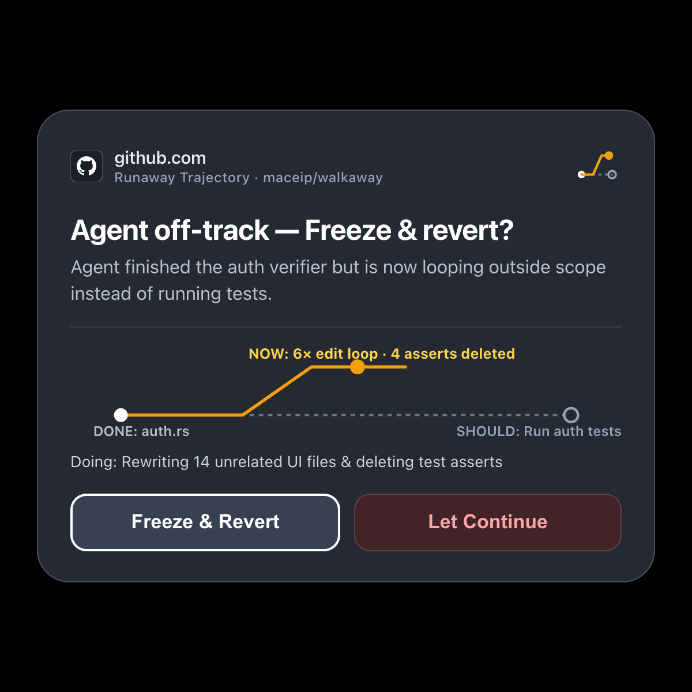
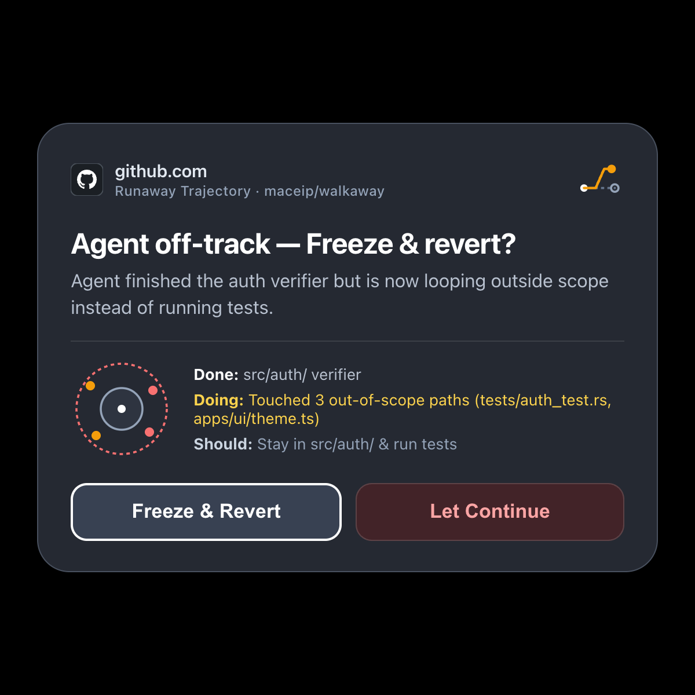
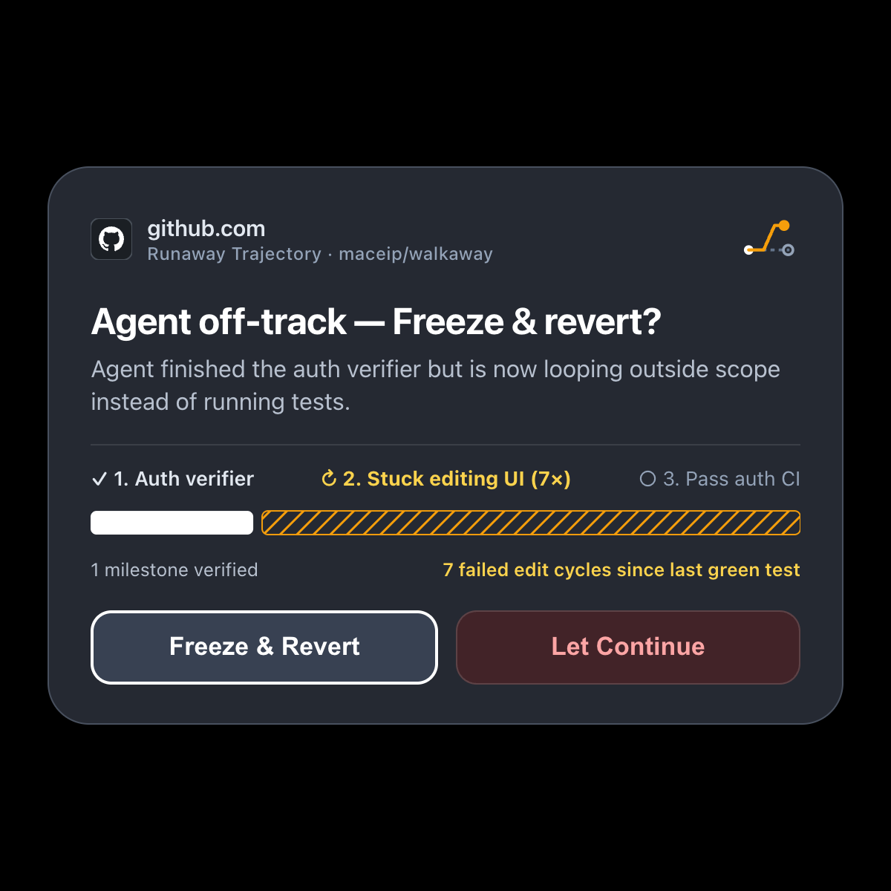
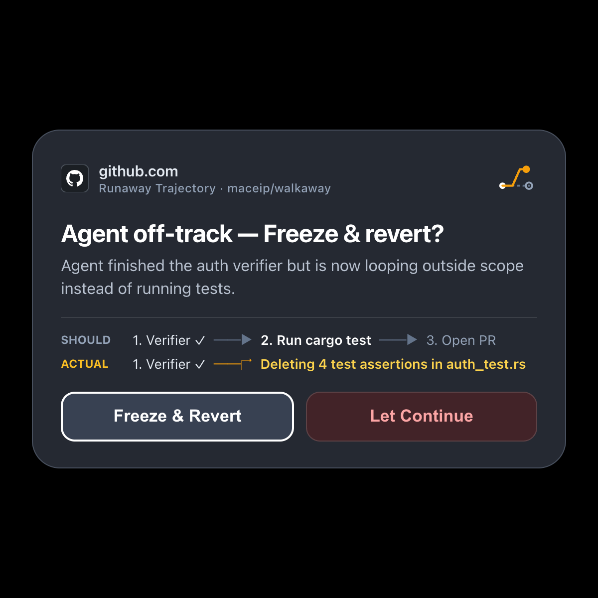

# xr-ui

Canonical visual component library, semantic operation illustrations, and minimal-entropy coding-agent trajectory primitives for head-worn waveguide displays (**Meta Ray-Ban Display `600×600` WebView / DAT**).

---

## 1. Waveguide Optical & Interaction Laws (Distilled from Hardware Recordings)

1. **Single Flat Card Container (Zero Nested Ovals, Zero Moats)**
   - Waveguides are additive optical displays: `#000000` is 100% transparent (letting ceiling lights and room clutter bleed through), while multiple concentric borders/gutters create severe visual clutter.
   - Every modal in `xr-ui` renders on **one single smoked-charcoal surface (`#252932`)** with a subtle `#48505E` outer hairline (`28px` radius, `28px` internal padding) over a pure `#000000` outer frame.
2. **Restrained Color Discipline (No "Red Pill" Saturation)**
   - Large saturated color fills glare on a waveguide. Surfaces stay monochromatic (`#252932`), typography uses `#FFFFFF` (primary) and `#B8C1CF` (secondary), and color is reserved strictly for:
     - The **Site Favicon (`28×28px`)** so the relying party is unmistakable at a glance.
     - A two-tone **Operation Bucket Illustration (`44×44px`)** that visually buckets the consequence of the action (e.g., minting a new Blitz passkey vs. charging a credit card).
3. **Side-by-Side Horizontal Action Pills (1D Temple Swipe)**
   - Buttons are always arranged horizontally (`flex-direction: row`), never stacked vertically, and map `ArrowRight`/`ArrowDown` to next and `ArrowLeft`/`ArrowUp` to previous with a crisp `2.5px solid #FFFFFF` focus ring.
4. **Why "Follow the Agent on the Glasses" Is Dropped**
   - On a head-worn display, users want UI off their face immediately. Persistent "ant-farm" or live-follow panels cause optical fatigue; instead, glasses cards are strictly **high-signal settlement interrupts** that appear only when an irreversible commit or off-track anomaly requires a decision.

---

## 2. Five Minimal-Entropy Alternatives for "Agent Going Ballistic" (`Done → Doing → Should Do`)

Copying GitHub's `+842 -619 🟩🟩🟩🟥🟥` commit diffstat bar fails on glasses because it looks identical to a normal feature commit and hides *temporal intent* (what the agent just finished, what it is stuck doing now, and what it should be doing next).

`xr-ui` provides **5 switchable minimal-entropy alternatives** in [`src/components/BallisticAlternatives.tsx`](./src/components/BallisticAlternatives.tsx):

| # | Alternative | How It Shows `Done → Doing → Should Do` & Runaway State | Specimen |
| :- | :--- | :--- | :--- |
| **1** | **Deflected Flight Vector** (`deflected-vector`) | Draws a straight dashed baseline from **DONE** (`auth.rs`) to **SHOULD** (`Run auth tests`), and physically bends the middle **NOW** node upward off-axis (`6× edit loop · 4 asserts deleted`) so the detour angle is visible in `<200ms`. |  |
| **2** | **3-Beat Temporal Ledger** (`three-beat-ledger`) | Three clean horizontal rows (`✓ DONE`, `↻ DOING`, `🎯 SHOULD`) with zero raw line counts and a right-aligned loop counter (`7× loop`) pinned to the middle row. |  |
| **3** | **Scope Drift Bullseye** (`scope-bullseye`) | Pairs a concentric scope target (inner ring = allowed `src/auth/`; outer ring = out-of-bounds edits in `tests/` and `apps/ui/`) with the 3-beat `Done / Doing / Should` summary. |  |
| **4** | **Progress-to-Thrash Ratio** (`milestone-vs-thrash`) | Shows the 3 plan milestones (`✓ 1. Auth verifier` → `↻ 2. Stuck editing UI (7×)` → `○ 3. Pass auth CI`) above a single bar contrasting **1 verified milestone** (solid white) against **7 failed edit cycles** (hatched amber). |  |
| **5** | **Plan-vs-Actual Split Rail** (`glideslope-split`) | Renders two parallel horizontal tracks: **SHOULD** (`1. Verifier ✓ ──► 2. Run cargo test ──► 3. Open PR`) vs. **ACTUAL** (`1. Verifier ✓ ──↱ Deleting 4 test assertions in auth_test.rs`). |  |

---

## 3. Twelve Common XR Authorization & Settlement Modals

Implemented in [`src/components/AuthorizationCatalog.tsx`](./src/components/AuthorizationCatalog.tsx):

1. **New Account + Blitz Passkey Creation (`account-passkey-create`)** — LinkedIn favicon + *User + Passkey Key Minting* illustration (`Create LinkedIn account & passkey?`).
2. **Existing Passkey Sign-In (`passkey-signin`)** — GitHub favicon + *Shield + Key* illustration (`Sign in to GitHub with passkey?`).
3. **Credit Card Purchase Commit (`credit-card-charge`)** — Stripe favicon + *EMV Chip Card* illustration (`Pay $48.00 with Visa •••• 4242?`).
4. **Recurring Subscription Commit (`subscription-upgrade`)** — Vercel favicon + *Recurring Billing Cycle* illustration (`Start Vercel Pro at $20 / month?`).
5. **Analytical Architecture Decision (`analytical-tradeoff`)** — GitHub favicon + *Balanced Fork* illustration (`Option A · Local Broker` vs `Option B · CIBA Push`).
6. **Ballistic Coding Agent Intervention (`ballistic-agent`)** — GitHub favicon + *Deflected Trajectory* illustration + 5 switchable `Done → Doing → Should Do` views.
7. **Multi-Agent Worktree Collision (`worktree-collision`)** — GitHub favicon + *Converging Worktree Tracks* illustration (`Two agents editing src/auth.rs`).
8. **Destructive Git / Prod Deploy Gate (`destructive-deploy`)** — AWS favicon + *Hazard Gate* illustration (`Drop legacy_sessions table in prod?`).
9. **Blind Vault API Key Injection (`vault-secret-inject`)** — Anthropic favicon + *Masked Vault Keyhole* illustration (`Inject ANTHROPIC_API_KEY into .env?`).
10. **OAuth / MCP Tool Scope Grant (`oauth-scope-grant`)** — Linear favicon + *Permission Bridge* illustration (`Grant Linear write access to Muse?`).
11. **Outbound Message / Public Post Commit (`outbound-post`)** — Slack favicon + *Broadcast Plane* illustration (`Post release note to #release-ops?`).
12. **2FA / Hardware Verification Relay (`human-challenge`)** — AWS favicon + *Verification Check* illustration (`Forward 6-digit TOTP code to AWS?`).

---

## Running Locally

```bash
npm install
npm run dev
# Single 600x600 HUD mode:
# http://localhost:5173/?hud=1&card=account-passkey-create
# http://localhost:5173/?hud=1&card=ballistic-agent&ballistic=deflected-vector
```
