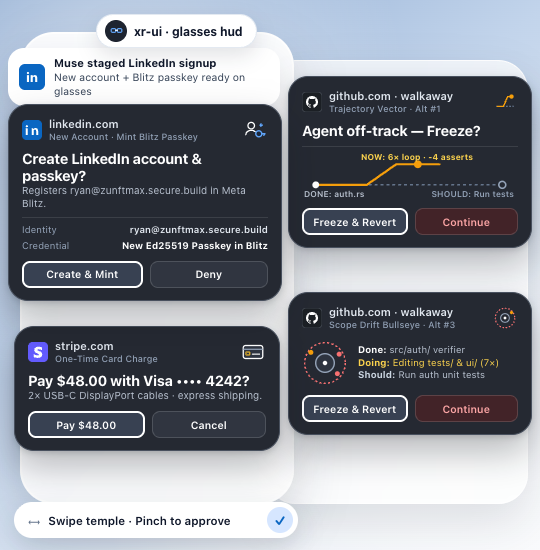

xr-ui is a visual component library for head worn displays and smart glasses like meta ray-ban display when autonomous agents work on your computer while you are away from your desk you still need to approve high consequence actions like creating accounts minting passkeys charging credit cards or stopping a coding agent that is going off the rails

putting normal desktop or phone interfaces on your face fails because waveguide lenses turn black pixels transparent and turn bright colors into blinding glare xr-ui solves this with one flat dark surface real site favicons simple two tone pictures for each action type and side by side buttons you can swipe and pinch in under a second so the screen gets off your face right away

for coding projects where an agent starts looping or drifting out of scope xr-ui also gives you five minimal ways to see what the agent just did what it is doing right now and what it should be doing next without confusing raw git diff bars or noisy live feeds

