xr-ui is a visual component library for head worn displays and smart glasses like meta ray-ban display. it gives autonomous agents a fast way to show menus status strips and approval prompts on your lens when you are away from your desk.

putting a little window on someone's face is unforgiving because black pixels turn transparent on a waveguide and pure white floods your eye with glare so every panel in xr-ui uses a single rounded surface in warm light gray that blocks room light behind the text without nested ovals or dark gutters. inside that light gray panel the selected choice rises up as an elevated 3d beveled button with a single clear verb like create pay revert or freeze so you never have to parse double actions and can swipe and pinch in under a second to get the window off your face.

instead of scattering icons across both corners xr-ui keeps visual anchors on the left by pairing the real site favicon with a universal deep blue-slate action tile that always sits in the same spot with a bold unmistakable symbol like a standalone passkey key a dollar tap coin or a hazard triangle. whether the screen is a vertical 3d selection menu a floating orb toolbar a live coding trajectory check or a one tap checkout card your eye immediately knows what bucket of action is happening before you even read the words.

---

## Core Design Pillars: Common Action Iconography & Organic Window Silhouettes

Before your eye focuses on a single word of text on a head-worn waveguide, `xr-ui` communicates the nature of the request through two pre-attentive visual channels:

1. **Universal Slate-Blue Action Iconography (`#33456B → #222E49`)**: Every window anchors icons exclusively on the left inside a `50×50` deep blue-slate tile with high-contrast, uncluttered vector strokes (`Passkey`, `Buy / Pay`, `Scope Shield`, `Vault Fill`, `Hazard`, `Code Loop`)—never splitting attention across both corners.
2. **Task-Shaped Window Silhouettes & Warm Light-Gray Shields (`#5C6069 → #4C4F58`)**: Instead of rendering every notification as the same rectangle, the outer perimeter of the light-blocking panel morphs into an unmistakable silhouette (`Human Head`, `Organic Whisper Leaf`, `Cumulus Cloud`, `Social Heart`, `Collapsing Black Hole`, `Commerce Price-Tag`), paired with elevated 3D beveled single-verb buttons.

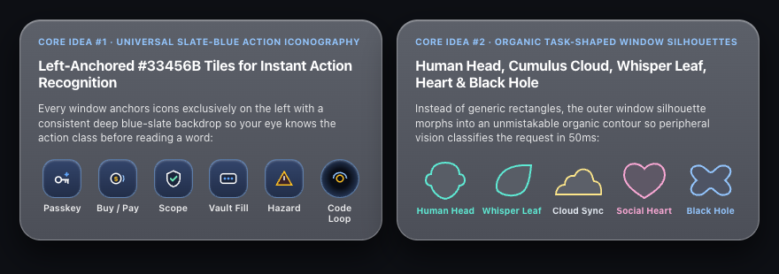

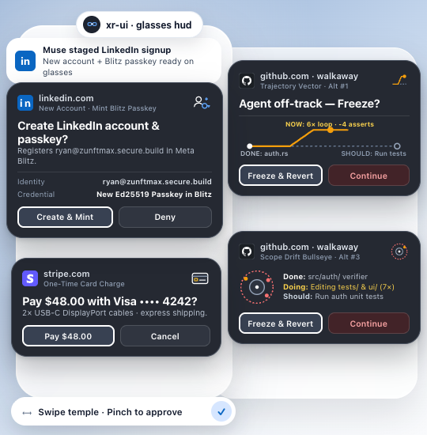

---

## 1. Unique Window Outlines

### 1.1 Organic & Metaphorical Task Silhouettes (Instant Human / Task Understanding)

To let peripheral vision classify an incoming request in under 50 milliseconds, `xr-ui` shapes the outer contour of the window itself after the human or task domain:

- **1 · Human Head Silhouette (`Identity / Account / Person`)**: Sculpted cranium dome, symmetrical side ear lobes, and tapered jawline/chin with a cyan specular rim—instantly signaling an identity or personal account action (`Mint Passkey?`).
- **2 · Organic Whisper Leaf (`Outbound Message / Quick Note`)**: Sweeping botanical leaf / speech-drop contour tapering to an upper-right apex—signaling an outbound message or quick whisper (`Post to #release?`).
- **3 · Cumulus Cloud Silhouette (`Cloud Sync / Remote Infrastructure`)**: Billowing triple-dome cloud contour anchored to a flat horizon base—signaling remote state synchronization (`Sync Vault to Cloud?`).
- **4 · Social Heart Silhouette (`Close Relationships / Family / DMs`)**: Twin rounded upper lobes and a tapered lower heart point—instantly distinguishable as a personal or social request (`Maya: "7pm sushi?"`).
- **5 · Collapsing Black-Hole Vortex (`Runaway Code / Repo Loop`)**: Inward-pinched gravitational waist with orbital accretion rings—signaling a background coding agent spiraling in a loop (`auth.rs 6× Loop`).
- **6 · Commerce Die-Cut Price-Tag (`Purchases & Checkout`)**: Angled hang-tag shoulder with a left punch eyelet and serrated right receipt teeth—signaling a payment decision (`$128 · Killshot 2`).

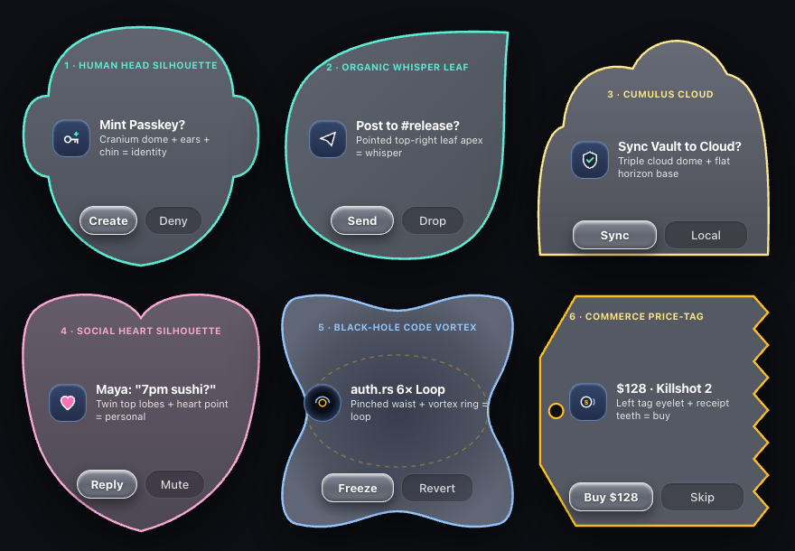

### 1.2 Structural Waveguide Window Outlines

For standard system menus, toolbars, and low-profile status strips, `xr-ui` provides 5 structural contours:

- **Structural #1 · Classic 26px Squircle Light-Shield**: Continuous `#5C6069 → #4C4F58` light-blocking rounded rectangle with a `1.5px` specular rim.
- **Structural #2 · Top-Notched Keystone Origin Tab**: Raised top-left origin tab housing the relying-party favicon outside the text reading lane.
- **Structural #3 · 45° Chamfered Telemetry Cutout**: Diagonal clipped corners with a left amber spine reserved for repo/telemetry alerts.
- **Structural #4 · Split-Deck Detached 3D Orb Toolbar + Card**: Floating circular 3D bevel orbs above a compact context card.
- **Structural #5 · Bottom Horizon Whisper Pill**: Ultra-low-profile capsule pinned to the lower monocular field, leaving 80% of the lens clear.

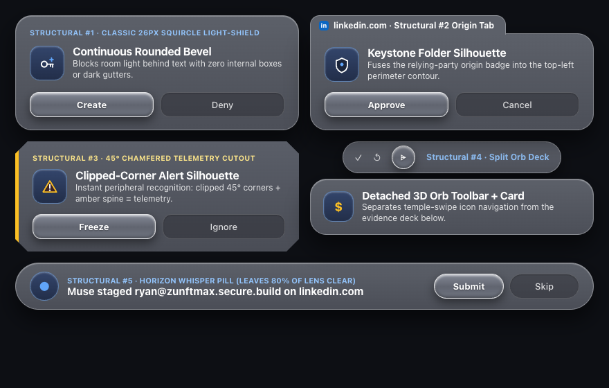

---

## 2. Project / Repo Activity — 5 Visualization Techniques to Reduce It Down

When a background coding agent is working across files or worktrees, dumping raw terminal logs onto a waveguide is unreadable. These 5 ballistic visualizations compress repo activity into a single glanceable geometry:

1. **Deflected Flight Vector (`DONE ──► ↱ DETOUR ──⇢ GOAL`)**: Plots verified commits along a horizontal baseline and bends physically off-axis (`#FBBF24` amber vector) when the agent enters a repetitive edit-test loop outside the plan.
2. **Scope Drift Bullseye (`Target Folder vs. Out-of-Bounds`)**: Concentric rings where the inner blue ring represents the authorized directory (`src/auth/`) and outer amber/red dots expose edits that escaped into unrelated folders (`tests/`, `ui/`).
3. **Verified Milestone vs. Wheel-Spin Thrash Bar**: Splits progress into solid high-luminance white blocks for green verified milestones versus diagonal amber hatch stripes for unverified edit-retry cycles since the last passing test.
4. **Worktree Swimlanes + Shared-File Collision Staple (`╫`)**: Parallel horizontal bars for concurrent git worktrees (`wt-auth` vs. `main`) bridged by a vertical red staple (`╫`) the moment two agents touch the same file (`auth.rs`).
5. **Plan-vs-Actual Glideslope Split + 3-Beat Temporal Receipt (`✓ DONE · ↻ DOING · → SHOULD`)**: Compresses 40+ tool calls into three fixed temporal rows—what verified milestone just landed (`✓ DONE`), what loop is running right now (`↻ DOING`), and the next planned verification gate (`→ SHOULD`).

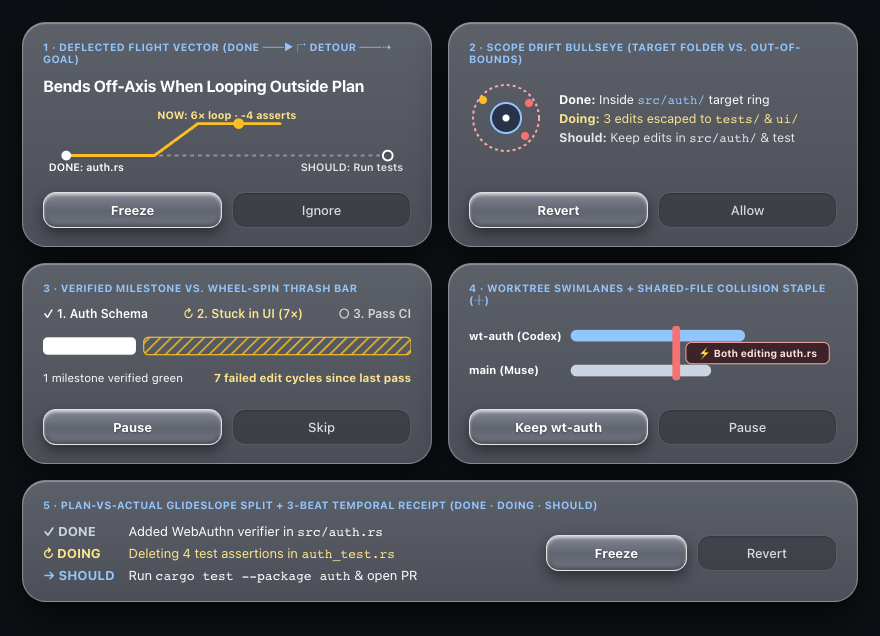

---

## 3. Strategies to Reduce Text from a Chatty LLM

### 3.1 What is the LLM Doing Right Now?

Instead of streaming paragraphs of chain-of-thought narration onto your face, `xr-ui` reduces live LLM execution to three compact ambient patterns:

- **Strategy 1 · 3-Word Verb + Target Pill**: Strips conversational filler down to `[Active Verb] + [Target] + [Field/Step Count]` (`Staging signup form · linkedin.com · 4 fields matched`).
- **Strategy 2 · 3-Bead Phase Stepper**: Replaces scrolling tool logs with a 3-stage spatial progress bar (`✓ 1. Read page DOM → ● 2. Filling Vault credentials → ○ 3. Await your pinch`).
- **Strategy 3 · Active Tool + Step Counter**: Pairs the Universal Slate-Blue Action Tile with the exact command and bounded step ratio (`2/3 · cargo test --auth · 12s elapsed`).

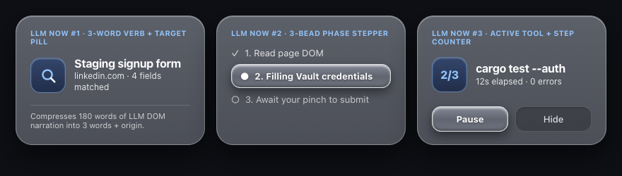

### 3.2 High-Pleasure, Sub-Second Decision Panels (Buying · Authorizing · World-Changing Writes)

When the LLM needs human approval, `xr-ui` pairs a left-hand visual anchor (product silhouette or Universal Slate-Blue Action Tile) with **at most 8–12 words** and a **single-verb 3D beveled primary button**:

#### Bucket A — Buying an Item (3 Compact Panels)
- **Buy Panel A1 · Product Image + Total Only**: Sneaker silhouette tile + `$128 · Nike Killshot 2` (`Size 10.5 · In stock · Visa •••• 4242`) + `Buy $128` 3D button.
- **Buy Panel A2 · Quantity + Arrival Receipt**: Contactless dollar coin tile + `$48 · 2× USB-C Cables` (`Arrives tomorrow · Free Prime shipping`) + `Pay $48` 3D button.
- **Buy Panel A3 · Product + Target Gauge**: Headphone silhouette tile + `$219 · Sony XM5` (`$61 below $280 target`) + `Buy $219` 3D button.

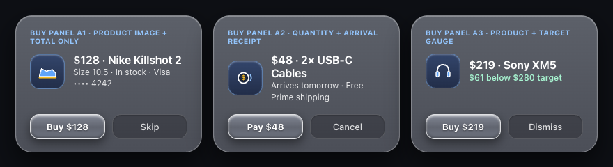

#### Bucket B — Authorizing an Action (3 Compact Panels)
- **Auth Panel B1 · Identity + Passkey Mint**: Standalone passkey tile + `Create LinkedIn account?` (`ryan@zunftmax.secure.build · Blitz Passkey`) + `Create` 3D button.
- **Auth Panel B2 · Visual Scope Chips**: Checkmark shield tile + `Grant Linear access?` (`✓ Issues · 🔒 No Billing`) + `Grant` 3D button.
- **Auth Panel B3 · Zero-Plaintext Vault Fill**: Masked vault field tile + `Inject ANTHROPIC_KEY?` (`sk-ant-••••9Q2A → walkaway/.env`) + `Inject` 3D button.

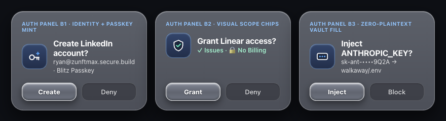

#### Bucket C — Making a "Write" Decision That Changes the World (3 Compact Panels)
- **Write Panel C1 · Before → After State Diff**: Hazard triangle tile + `Drop legacy_sessions?` (`14.2k rows → 0 (snapshot saved)`) + pre-focused `Abort` 3D button and `Drop`.
- **Write Panel C2 · Audience + 10-Word Quote**: Paper-plane broadcast tile + `Post to #release-ops (38)?` (`"Walkaway v0.4 shipped: 3D buttons live."`) + `Send` 3D button.
- **Write Panel C3 · World-Branching Fork**: Y-branch fork tile + `Choose passkey relay path` (`A: Local 18ms USB · B: Cellular 420ms`) + `Option A` / `Option B`.

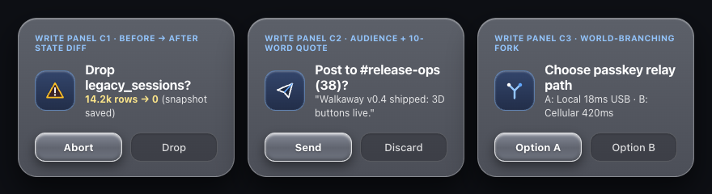

### 3.3 Expanded-Size Human Validation Panels (#1 Pick vs. #2 Runner-Up + Chat Validation)

When a one-line card isn't enough and the user wants to validate *why* the agent chose `#1` over `#2` (or asks a quick voice question like `"Why not the cheaper Samba?"`), the panel expands vertically to show **#1 Pick vs. #2 Considered Runner-Up** alongside a **1-exchange voice/chat validation strip**:

- **Expanded Buy Validation**: Compares `#1 · Nike Killshot 2 · $128 (Arrives tomorrow)` against `#2 · Adidas Samba OG · $115 ($13 cheaper · Ships in 5 days)` with voice Q&A (`🎙️ You: "Why not the $115 Samba?" → Muse: "Samba ships next Tuesday; Killshot arrives before your Friday flight."`) and `Buy #1` / `Buy #2` 3D buttons.
- **Expanded Auth Validation**: Compares `#1 · Read + Write Issues` against `#2 · Read-Only (1h TTL)` with voice Q&A (`🎙️ You: "Why does it need Write?" → Muse: "To open the 3 regression tickets from cargo test automatically."`) and `Grant #1` / `Use #2` buttons.
- **Expanded Write Validation**: Compares `#2 · Archive to S3 Parquet (Keeps 14.2k rows · 2s restore)` against `#1 · Drop legacy_sessions (14.2k rows → 0)` with voice Q&A and `Archive #2` / `Drop #1` buttons.

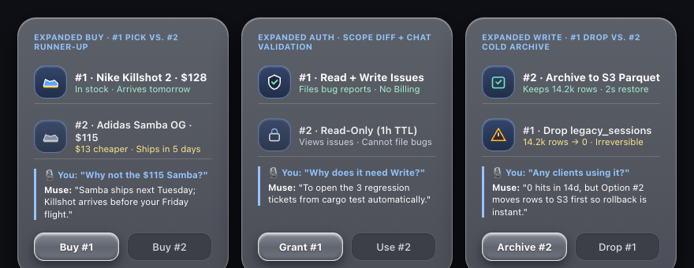

---

## 4. Generative UI Reality on Smart Glasses (`vercel-labs/json-render`)

What can and cannot be generated on the fly at runtime using Vercel's [`json-render`](https://github.com/vercel-labs/json-render) (`@json-render/core` + `defineCatalog` + Zod-constrained `SpecStream`) when targeting an optical waveguide display?

### What CAN Be Generated On-The-Fly (`SpecStream` JSON Output)
1. **Dynamic Template & Silhouette Selection**: The LLM can inspect the active tool call and pick which pre-registered `xr-ui` surface and window silhouette to mount (`HumanHeadWindow`, `CumulusCloudWindow`, `BlackHoleCodeWindow`, `ExpandedBuyValidation`, or `DeflectedVector`).
2. **Zod-Validated Data Hydration**: The LLM streams live prices (`$128` vs. `$115`), `#1 Pick` vs. `#2 Runner-Up` trade-off strings, file paths (`src/auth.rs`), scope badges (`✓ Issues`, `🔒 No Billing`), and 10-word voice validation answers into strict Zod-typed props.
3. **Parameterized Telemetry Coordinates**: The LLM feeds live numbers (`loopCount: 6`, `inScopeCount: 4`, `escapedFiles: 3`, `collisionFile: "auth.rs"`) into pre-built SVG visualization components.

### What CANNOT Be Generated On-The-Fly (Must Be Pre-Engineered in the `xr-ui` Registry)
1. **Organic & Metaphorical Window Silhouettes**: Letting an LLM generate raw SVG `<path d="...">` contours on the fly for a Human Head, Cumulus Cloud, Whisper Leaf, or Black Hole results in self-intersecting geometry and text clipping outside the optical shield. Window silhouettes must be hand-crafted in the `xr-ui` registry and selected via enum (`outline: z.enum(["human_head", "whisper_leaf", "cumulus_cloud", "social_heart", "black_hole", "price_tag"])`).
2. **Waveguide Optical Physics & 3D Beveled Buttons**: Unconstrained LLM CSS routinely emits `#FFFFFF` white backgrounds (causing waveguide bloom/glare) or `#000000` black boxes (creating transparent holes over bright rooms). The `#5C6069 → #4C4F58` light-blocking surface and `#838895 → #616570` 3D specular button bevels must be locked inside `InferCatalogComponents<typeof catalog>`.
3. **Micro-Legible `50×50` Action Iconography**: Freeform LLM-generated SVGs turn into unrecognizable overlapping strokes at `50×50` waveguide scale. Action icons must be pre-authored in the Universal Slate-Blue Action Tile library and referenced by semantic key.

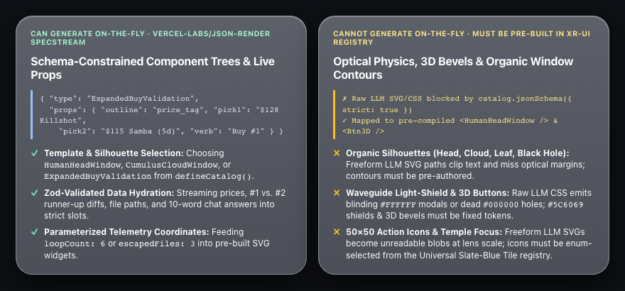
