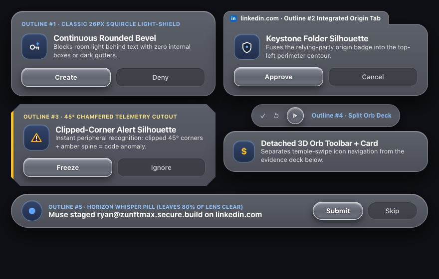
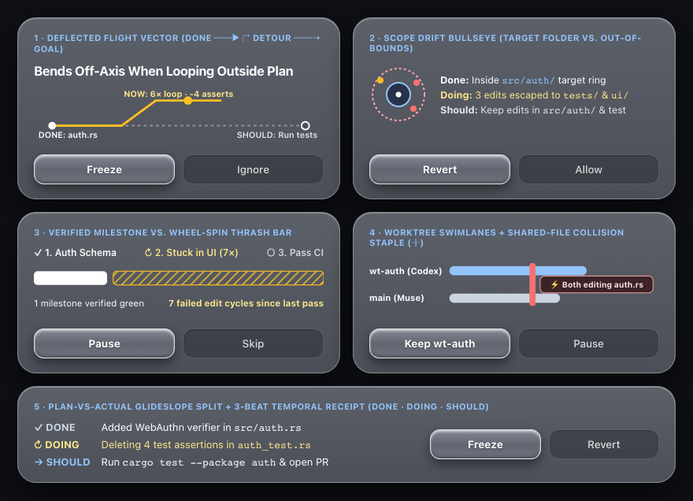
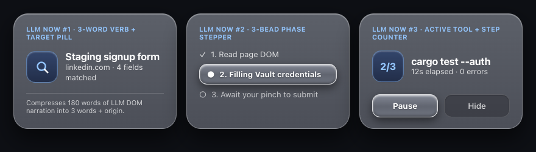
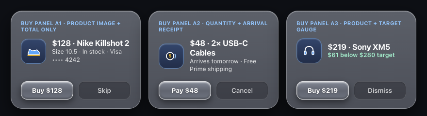
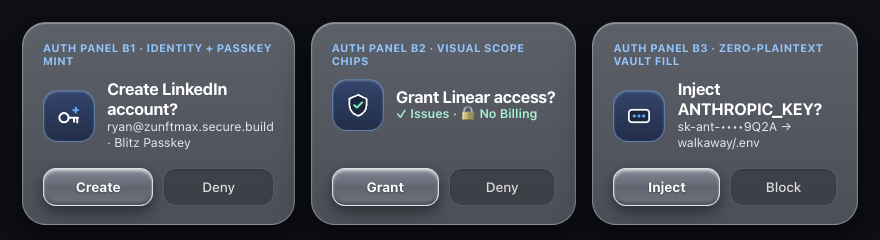
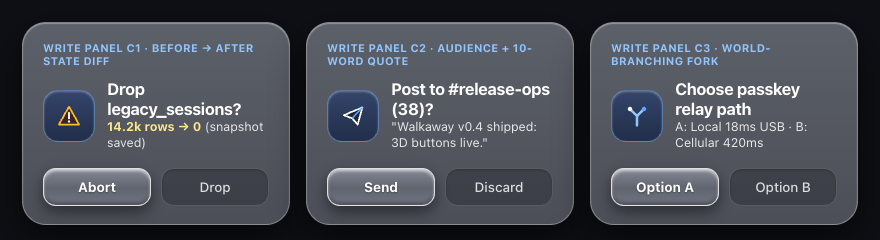

xr-ui is a visual component library for head worn displays and smart glasses like meta ray-ban display. it gives autonomous agents a fast way to show menus status strips and approval prompts on your lens when you are away from your desk.

putting a little window on someone's face is unforgiving because black pixels turn transparent on a waveguide and pure white floods your eye with glare so every panel in xr-ui uses a single rounded rectangle in warm light gray that blocks room light behind the text without nested ovals or dark gutters. inside that light gray panel the selected choice rises up as an elevated 3d beveled button with a single clear verb like create pay revert or freeze so you never have to parse double actions and can swipe and pinch in under a second to get the window off your face.

instead of scattering icons across both corners xr-ui keeps visual anchors on the left by pairing the real site favicon with a universal deep blue-slate action tile that always sits in the same spot with a bold unmistakable symbol like a standalone passkey key a dollar tap coin or a hazard triangle. whether the screen is a vertical 3d selection menu a floating orb toolbar a live coding trajectory check or a one tap checkout card your eye immediately knows what bucket of action is happening before you even read the words.

---

## 1. Unique Window Outlines

Different head-worn tasks require distinct outer silhouettes so your peripheral vision immediately distinguishes an interactive menu, an origin-stamped notification, a live background telemetry check, a floating tool dock, or an ambient whisper strip:

- **1A · Classic 26px Squircle Light-Shield**: Continuous `#5C6069 → #4C4F58` light-blocking rounded rectangle with a `1.5px` specular rim for primary menus and single-verb decisions.
- **1B · Top-Notched Keystone Origin Tab**: Raised top-left origin tab housing the favicon + Universal Slate-Blue Action Tile so the source app and action category sit outside the text reading lane.
- **1C · 45° Chamfered Telemetry Cutout**: Diagonal top-right corner bevel (`clip-path` polygon) reserved exclusively for background repo/agent health checks so your eye never confuses telemetry with a personal message.
- **1D · Split-Deck Detached 3D Orb Toolbar + Card**: Floating circular 3D bevel orbs above a compact context card for multi-mode spatial tools (`Pause`, `Logs`, `Diff`, `Voice`).
- **1E · Bottom Horizon Whisper Pill**: Ultra-low-profile `56px` capsule pinned to the lower monocular field for passive background progress without blocking forward walking vision.

---

## 2. Project / Repo Activity — 5 Visualization Techniques to Reduce It Down

When a background coding agent is working across files or worktrees, dumping raw terminal logs onto a waveguide is unreadable. These 5 ballistic visualizations compress repo activity into a single glanceable geometry:

1. **Deflected Flight Vector (`DONE ──► ↱ DETOUR ──⇢ GOAL`)**: Plots verified commits along a horizontal baseline and bends physically off-axis (`#FCD34D` amber vector) when the agent enters a repetitive edit-test loop outside the plan.
2. **Scope Drift Bullseye (`Target Folder vs. Out-of-Bounds`)**: Concentric rings where the inner blue ring represents the authorized directory (`src/auth/`) and outer amber dots expose edits that escaped into unrelated folders (`tests/`, `ui/`).
3. **Verified Milestone vs. Wheel-Spin Thrash Bar**: Splits progress into solid high-luminance white blocks for green verified milestones versus diagonal amber hatch stripes for unverified edit-retry cycles since the last passing test.
4. **Worktree Swimlanes + Shared-File Collision Staple (`╫`)**: Parallel horizontal bars for concurrent git worktrees (`wt-auth` vs. `main`) bridged by a vertical red/amber staple (`╫`) the moment two agents touch the same file (`auth.rs`).
5. **Plan-vs-Actual Glideslope Split + 3-Beat Temporal Receipt (`✓ DONE · ↻ DOING · → SHOULD`)**: Compresses 40+ tool calls into three fixed temporal rows—what verified milestone just landed (`✓ DONE`), what loop is running right now (`↻ DOING`), and the next planned verification gate (`→ SHOULD`).

---

## 3. Strategies to Reduce Text from a Chatty LLM

### 3.1 What is the LLM Doing Right Now?

Instead of streaming paragraphs of chain-of-thought text onto your face, `xr-ui` reduces live LLM execution to three compact ambient patterns:

- **Strategy 1 · 3-Word Verb + Target Pill**: Strips conversational filler down to `[Active Verb] + [File/Target] + [Elapsed Time]` (`Editing auth.rs · 12s`).
- **Strategy 2 · 3-Bead Phase Stepper**: Replaces scrolling tool logs with a 3-stage spatial progress bar (`✓ Read → ● Patch → ○ Test`).
- **Strategy 3 · Active Tool + Step Counter**:Pairs the Universal Slate-Blue Action Tile with the exact command and bounded step ratio (`cargo test · Step 3/4 · 42 passed`).

### 3.2 High-Pleasure, Sub-Second Decision Panels (Buying · Authorizing · World-Changing Writes)

When the LLM needs human approval, `xr-ui` pairs a left-hand visual anchor (product silhouette or Universal Slate-Blue Action Tile) with **at most 8–12 words** and a **single-verb 3D beveled primary button**:

#### Bucket A — Buying an Item (3 Panels)
- **Buy Panel A1 · Product Image + Total Only**: Renders the product illustration on the slate-blue tile, item name + total price (`$128 · Nike Killshot 2`), size/card metadata, and a single `Buy $128` 3D button.
- **Buy Panel A2 · Quantity + Arrival Receipt**: Highlights unit count, total price, and delivery promise (`$48 · 2× USB-C Cables · Arrives tomorrow`) with a single `Pay $48` 3D button.
- **Buy Panel A3 · Product + Price Target Gauge**: Shows the item silhouette alongside how far the live price sits below your target (`$219 · Sony XM5 · $61 below $280 target`) with a single `Buy $219` 3D button.

#### Bucket B — Authorizing an Action (3 Panels)
- **Auth Panel B1 · Identity + Passkey Mint**: Uses the standalone horizontal passkey icon in the Universal Slate-Blue Action Tile, account handle (`ryan@zunftmax.secure.build`), and a single `Create` 3D button.
- **Auth Panel B2 · Permission Shield + Visual Scope Chips**: Replaces OAuth legal prose with a checkmark shield icon and two color-coded scope pills (`✓ Issues · 🔒 No Billing`) plus a single `Grant` 3D button.
- **Auth Panel B3 · Zero-Plaintext Vault Fill**: Shows the masked vault input symbol, redacted key fingerprint (`sk-ant-••••9Q2A → walkaway/.env`), and a single `Inject` 3D button.

#### Bucket C — Making a "Write" Decision That Changes the World (3 Panels)
- **Write Panel C1 · Before → After State Diff**: Summarizes destructive mutations as a concrete numeric delta (`14.2k rows → 0 (snapshot saved)`) next to the hazard triangle tile, with `Abort` pre-focused in 3D bevel and `Drop` recessed.
- **Write Panel C2 · Broadcast Audience + 10-Word Quote**: Pairs the paper-plane broadcast tile with the exact recipient count (`#release-ops (38)`) and a 7-word preview quote, backed by a single `Send` 3D button.
- **Write Panel C3 · World-Branching Architectural Fork**: Uses the Y-branch fork tile to compare two mutually exclusive execution paths (`A: Local 18ms USB · B: Cellular 420ms`) with single-choice `Option A` and `Option B` buttons.

